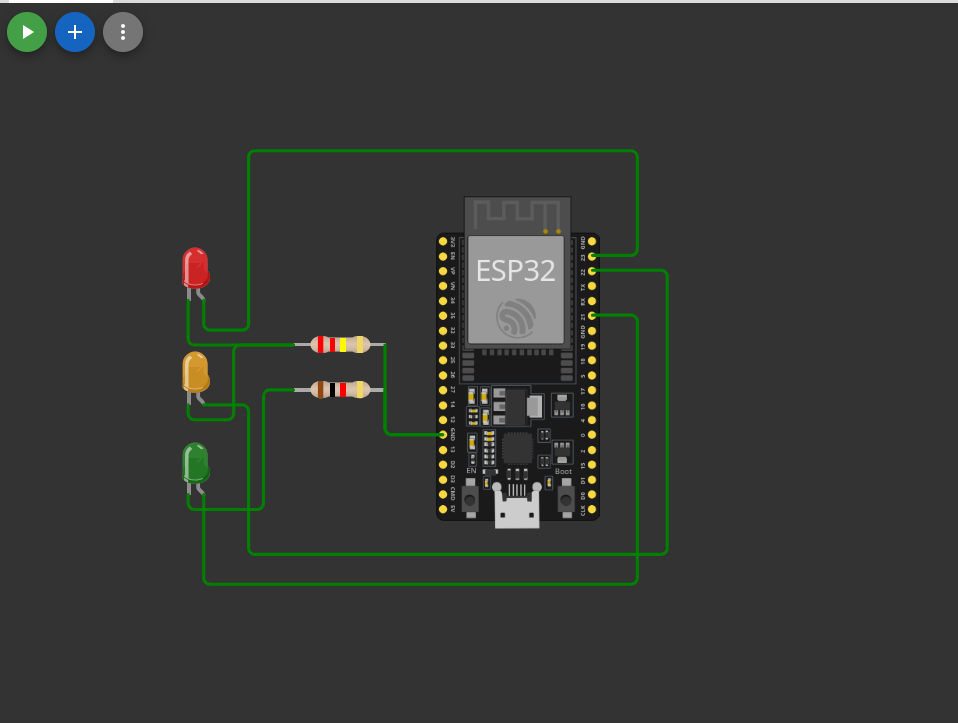

# Semáforo Inteligente com ESP32

Projeto de simulação de um semáforo eletrônico utilizando a placa ESP32, três LEDs e programação em C com ESP-IDF e FreeRTOS. O circuito foi desenvolvido e testado virtualmente na plataforma Wokwi.

## Sobre o Projeto

O projeto consiste no desenvolvimento de um sistema de sinalização de trânsito utilizando um microcontrolador ESP32 como unidade de controle.

A proposta é simular o funcionamento de um semáforo convencional por meio de três LEDs (vermelho, amarelo e verde), controlados individualmente por pinos GPIO da placa. A alternância dos sinais ocorre automaticamente, seguindo intervalos de tempo definidos no código-fonte.

O desenvolvimento foi realizado no Wokwi, uma plataforma de simulação que permite representar circuitos eletrônicos e testar a integração entre hardware e software sem a necessidade de componentes físicos.

## Tecnologias e Ferramentas

- **ESP32:** Microcontrolador responsável pelo controle do circuito.
- **Linguagem C:** Utilizada no desenvolvimento da lógica de controle.
- **ESP-IDF:** Framework oficial utilizado para programação da ESP32.
- **FreeRTOS:** Sistema operacional de tempo real utilizado para gerenciamento da execução e temporização das tarefas.
- **Wokwi:** Ambiente de simulação eletrônica.

## Componentes Utilizados

| **Componente** | **Quantidade** |
| -------------- | -------------- |
| ESP32          | 1              |
| LED Vermelho   | 1              |
| LED Amarelo    | 1              |
| LED Verde      | 1              |
| Resistores     | 2              |

## Montagem do Circuito

A montagem foi realizada virtualmente no Wokwi, utilizando a placa ESP32 como unidade central de controle. Foram adicionados três LEDs de cores diferentes, representando os sinais de um semáforo convencional.

As conexões foram realizadas entre os pinos GPIO da ESP32 e os LEDs, utilizando resistores para limitar a corrente elétrica. Os resistores foram conectados ao terminal GND da placa conforme a montagem simulada.

*Figura 1 — Circuito eletrônico do semáforo simulado na plataforma Wokwi.*

### Mapeamento dos Pinos GPIO

| **Sinal** | **Pino GPIO** | **Função**       |
| --------- | ------------- | ---------------- |
| Vermelho  | GPIO 23       | Indicar parada   |
| Amarelo   | GPIO 22       | Indicar atenção  |
| Verde     | GPIO 21       | Indicar passagem |

## Funcionamento do Sistema

O software foi desenvolvido em C utilizando as bibliotecas do ESP-IDF e os recursos do FreeRTOS. Inicialmente, os pinos GPIO 23, 22 e 21 são configurados como saídas digitais, permitindo o controle individual dos LEDs.

Após a inicialização, o programa executa um laço de repetição contínuo (`while (1)`), responsável por alternar os sinais do semáforo.

### Sequência de Sinalização

| **Etapa** | **LED Ativo** | **Duração** |
| --------- | ------------- | ----------- |
| 1         | Verde         | 6 segundos  |
| 2         | Amarelo       | 3 segundos  |
| 3         | Vermelho      | 6 segundos  |

O ciclo completo possui duração de 15 segundos e é repetido continuamente.

## Código-Fonte

O código principal está disponível no arquivo `src/main.c`. O controle dos LEDs utiliza as seguintes funções principais:

- `gpio_reset_pin()`: Reinicializa a configuração do pino.
- `gpio_set_direction()`: Configura o pino como entrada ou saída.
- `gpio_set_level()`: Define o nível lógico do pino, ligando ou desligando o LED.
- `vTaskDelay()`: Realiza a temporização da execução utilizando o FreeRTOS.

## Testes e Simulação

Os testes foram realizados no ambiente Wokwi, utilizando a simulação da ESP32 e dos componentes eletrônicos conectados. Durante a execução, foi possível observar a alternância dos três LEDs conforme os intervalos definidos no programa. O sistema executa a sequência de sinalização continuamente, sem necessidade de intervenção manual.

## Objetivos de Aprendizagem

- Compreender a utilização dos pinos GPIO da ESP32.
- Desenvolver lógica de controle de componentes eletrônicos.
- Aplicar conceitos de programação em C para sistemas embarcados.
- Utilizar recursos de temporização do FreeRTOS.
- Explorar a integração entre hardware e software por meio de simulação eletrônica.

## Autoria

Projeto desenvolvido como atividade acadêmica com o objetivo de explorar a programação de microcontroladores e a simulação de circuitos eletrônicos.